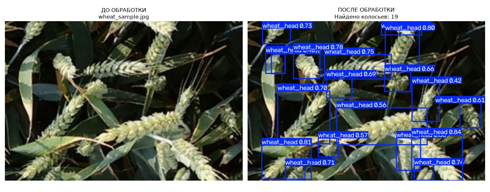

# Детекция колосьев пшеницы

Модель YOLOv8n находит колосья пшеницы на фотографиях поля и считает их.
Проект оформлен как пакет Python: одна команда `wheat-detection`,
настройки в YAML, тесты, проверка кода перед каждым коммитом и CI.



## Быстрый старт

Нужны:

- Python от 3.11 до 3.14 (кроме 3.14.1: с ней не ставится torchvision);
- Poetry 2.x;
- Git с Git LFS (в Git для Windows LFS уже входит).

```bash
git clone <адрес репозитория> wheat_detection
cd wheat_detection
git lfs install                  # один раз на компьютере
git lfs pull                     # скачать веса models/best.pt
poetry install                   # создать .venv и поставить зависимости
poetry run pre-commit install    # включить проверки перед коммитом
poetry run wheat-detection predict путь/к/фото.png
```

Poetry ставится командой `pipx install poetry` или официальным
установщиком: https://python-poetry.org/docs/#installation

## Команды

| Было | Стало |
|------|-------|
| `python scripts/detect_drag.py` | `poetry run wheat-detection predict` (спросит путь, файл можно перетащить в окно) или `predict фото.png` |
| `python scripts/detect_random.py` | `poetry run wheat-detection predict --random` |
| `python scripts/befor_after_random.py` | `poetry run wheat-detection compare --random` |
| `python scripts/train.py` | `poetry run wheat-detection train` |
| не было | `poetry run wheat-detection split-data` |

Результаты сохраняются в `runs/predict/<имя>_pred.jpg` и
`runs/compare/<имя>_compare.png`. Флаг `--show` сразу открывает картинку.

Полезные флаги: `--conf 0.4` (порог уверенности), `--device cpu`,
`--weights путь.pt`, `--seed 1` (повторяемый выбор для `--random`),
`--output-dir папка`, `-v` (подробный вывод). Полный список:
`poetry run wheat-detection predict --help`.

Чтобы не писать `poetry run`, активируйте окружение:

- Windows PowerShell: `.venv\Scripts\Activate.ps1`
- Linux и macOS: `source .venv/bin/activate`

Команды `poetry shell` из лекции в Poetry 2 больше нет (она вынесена
в отдельный плагин), вместо неё `poetry env activate` печатает нужную
команду активации.

## Настройки

Все параметры собраны в `configs/config.yaml`: пути, обучение,
предсказание. Источники по возрастанию силы:

1. значения по умолчанию в `src/wheat_detection/config.py`;
2. `configs/config.yaml` (или свой файл через `-c`);
3. переменные окружения `WHEAT_<РАЗДЕЛ>__<ПАРАМЕТР>`, например
   `WHEAT_PREDICT__DEVICE=cpu`. Их можно записать в `.env` (образец
   в `.env.example`, сам `.env` в git не попадает);
4. флаги командной строки.

Опечатка в имени параметра или недопустимое значение (например,
`conf: 2`) останавливает запуск с понятным сообщением.

## Обучение

1. Положите данные в `data/` по схеме из [data/README.md](data/README.md).
2. `poetry run wheat-detection split-data` делит фото на train и val
   (80 на 20, seed 42). Проверочные фото в обучение не попадают.
3. `poetry run wheat-detection train` обучает модель. Если шаг 2
   пропущен, разбиение сделается само. Результаты в `runs/train/<дата>`.
4. Если новая модель лучше, скопируйте `runs/train/<дата>/weights/best.pt`
   в `models/best.pt` и закоммитьте: файл уйдёт в Git LFS.

### Видеокарта под Windows

torch из PyPI для Windows считает только на процессоре. Чтобы обучать
на видеокарте, после `poetry install` поставьте сборку с CUDA:

```powershell
poetry run pip install --force-reinstall --no-deps torch==2.14.1 torchvision==0.29.1 --index-url https://download.pytorch.org/whl/cu126
poetry run python -c "import torch; print(torch.cuda.is_available())"
```

Вторая команда должна вывести `True`. После `poetry install` или
`poetry sync` первую команду нужно повторить: Poetry вернёт версию
из `poetry.lock`.

## Проверка кода

Перед каждым коммитом pre-commit запускает:

| Проверка | Что делает |
|----------|------------|
| black | форматирует код |
| isort | сортирует импорты |
| flake8 + bugbear | стиль PEP 8, типичные ошибки, сложность функций |
| mypy (strict) | проверяет типы |
| pre-commit-hooks | пробелы, переводы строк, YAML и TOML, большие файлы, закрытые ключи |
| poetry check --lock | `pyproject.toml` корректен и совпадает с `poetry.lock` |

Длина строки во всех инструментах 79 символов, как в PEP 8.
Настройки лежат в `pyproject.toml` и `.flake8`.

```bash
poetry run pre-commit run --all-files   # все проверки по всем файлам
poetry run pytest                       # тесты
poetry run pytest --cov                 # тесты и покрытие кода
```

В большинстве тестов модель подменена заглушкой, поэтому они идут
секунды и не требуют видеокарты. Тесты на настоящей модели
(`tests/test_integration.py`, метка `slow`) пропускаются, если веса
не скачаны.

## Окружение в репозитории

Само окружение (`.venv`) в git не хранится, хранится его точное описание:

| Файл | Зачем |
|------|-------|
| `pyproject.toml` | зависимости и настройки инструментов |
| `poetry.lock` | точные версии всех пакетов: у всех одинаковое окружение |
| `poetry.toml` | окружение создаётся в `.venv` внутри проекта, его сразу видят VS Code и PyCharm |
| `.gitignore` | не пускает в git `.venv`, данные, результаты запусков и `.env` |
| `.gitattributes` | переводы строк LF у всех, веса `models/*.pt` через Git LFS |

Как менять зависимости:

```bash
poetry add пакет                # нужен для работы программы
poetry add --group dev пакет    # нужен только разработчику (или --dev)
poetry update                   # обновить версии в пределах ограничений
poetry sync                     # привести .venv точно к poetry.lock
```

`pyproject.toml` и `poetry.lock` коммитятся вместе. Если забыть обновить
`poetry.lock`, коммит остановит проверка `poetry check --lock`.

## Метрики исходной модели

`models/best.pt`: YOLOv8n, 50 эпох, imgsz 640, batch 16. Графики
и таблица по эпохам в `reports/baseline/`.

| precision | recall | mAP50 | mAP50-95 |
|-----------|--------|-------|----------|
| 0.930 | 0.907 | 0.964 | 0.607 |

Эти цифры завышены: в исходной версии проверка шла на тех же фото,
что и обучение. Честные метрики даст переобучение после `split-data`.

Что изменилось по сравнению с исходными скриптами: [CHANGELOG.md](CHANGELOG.md).
